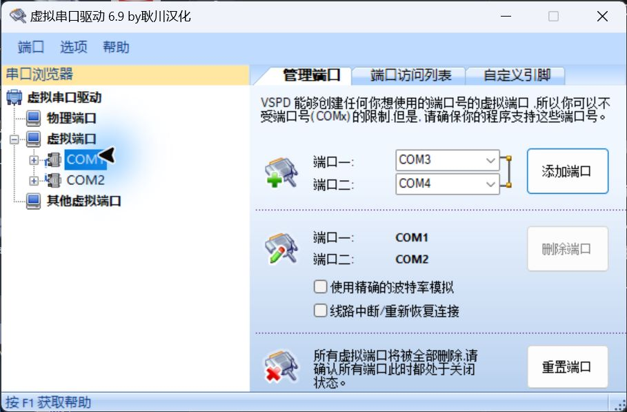
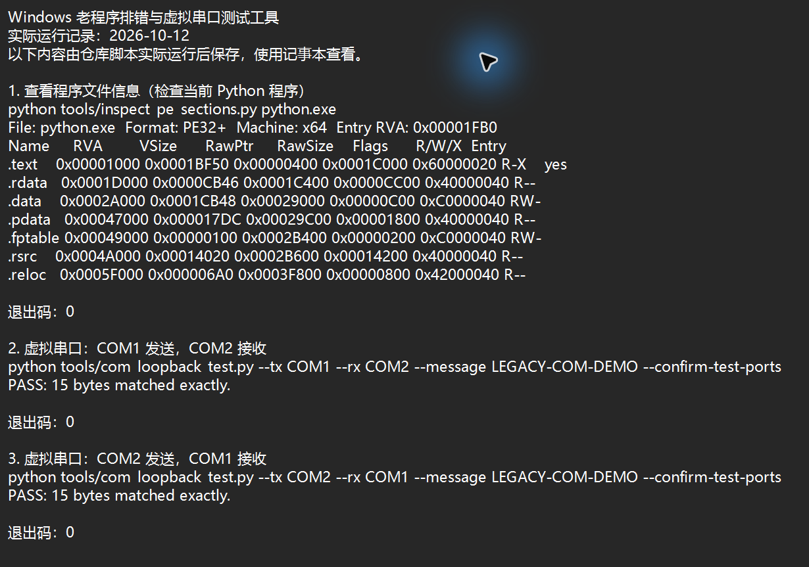

# Windows 老程序排错与虚拟串口测试工具

老程序一打开就退出，或者虚拟串口连好了却不知道能不能收发数据，可以用这里的脚本做一些基础检查。

仓库里有两个小工具：一个查看 EXE、DLL 文件的结构和权限，另一个向测试串口发送数据，检查另一端收到的内容是否一致。遇到程序闪退时，也可以参考[排查记录](docs/anonymous-case-study.md)，了解该从哪些信息查起。

## 看看实际效果

### 虚拟串口软件界面

下面是本机虚拟串口软件的实际截图。选中 COM1 后，可以看到它与 COM2 配成一对：从一端发送的数据，可以在另一端接收。



这是单独安装的第三方软件，用来准备测试端口；本仓库提供的是检查和测试脚本，不包含这款软件或驱动。截图仅用于说明测试环境。

### 仓库工具运行结果

下面是 2026 年 10 月 12 日实际运行脚本后保存的结果，在记事本中打开截图。文件检查使用本机 Python 程序，因此显示的是 x64；串口测试使用上图中的 COM1、COM2，两个方向各发送了 15 字节，均收到相同内容。



这次测试说明这对虚拟串口能够双向收发数据，不代表已经验证真实 PLC、RS485 接线或现场设备通信。

## 怎么用

先安装 Python 3，在仓库目录中执行下面的命令。只有串口测试需要安装额外依赖；文件检查只用 Python 自带的库。

### 查看 EXE 或 DLL 的信息

把命令中的文件名换成你有权检查的文件：

```powershell
python tools/inspect_pe_sections.py "sample-authorized-file.exe"
```

输出里可以看到程序的架构、入口地址，以及各个节区的权限。节区可以理解为程序文件中存放不同内容的区域：`R` 表示可读，`W` 表示可写，`X` 表示可执行，`-` 表示没有该权限。

需要把结果交给其他程序处理时，可以输出 JSON：

```powershell
python tools/inspect_pe_sections.py "sample-authorized-file.dll" --json
```

脚本只读取文件，不会改动它，也不会自动修复闪退。它显示的是文件中的权限标记；要判断崩溃原因，还需要结合异常记录和运行时的内存权限。

### 测试一对虚拟串口

先安装依赖：

```powershell
python -m pip install -r requirements.txt
```

在虚拟串口软件中准备一对专门用于测试的端口，确认没有连接真实设备，再运行：

```powershell
python tools/com_loopback_test.py --tx COM1 --rx COM2 --confirm-test-ports
```

`--tx` 是发送端，`--rx` 是接收端。把 COM1、COM2 换成你实际使用的端口号。脚本默认使用 9600 波特率，等待接收的超时时间为 2 秒。

看到 `PASS` 表示这次收到的数据与发送的数据一致。要测试反方向，把两个端口对调，再运行一次：

```powershell
python tools/com_loopback_test.py --tx COM2 --rx COM1 --confirm-test-ports
```

`--confirm-test-ports` 表示你已确认两端都是隔离的测试端口。脚本不能替你识别端口是否连接了真实设备，请勿对 PLC、变频器、仪表或生产设备使用这条命令。

## 老程序闪退时，从哪里查起

先看 Windows 的错误记录，找到异常代码、出错模块和访问类型，再对照程序文件的信息。

例如，DEP（数据执行保护）会阻止程序在没有执行权限的内存页上运行代码。如果错误记录显示程序尝试在这样的区域执行代码，就需要进一步核对故障地址和内存权限。仅凭“程序很旧”或 `0xc0000005` 这个错误码，无法确定是 DEP 导致的。

具体过程见[老程序启动后闪退：一份排查记录](docs/anonymous-case-study.md)。第三方软件的兼容问题，优先找厂商提供的更新或补丁，不建议关闭整机 DEP。

## 仓库里的其他文件

| 文件 | 用途 |
| --- | --- |
| `tools/inspect_pe_sections.py` | 查看程序文件的结构和权限 |
| `tools/com_loopback_test.py` | 检查测试串口的数据收发 |
| `tools/release_audit.py` | 发布前检查禁止上传的文件类型和常见敏感信息 |
| `tests/` | 文件检查工具的自动化测试 |

修改仓库后，可以运行：

```powershell
python -m unittest discover -s tests -v
python tools/release_audit.py .
```

自动检查不能代替人工检查，截图和文字也需要确认没有泄露隐私。

## 文件和许可证说明

这里公开的是原创脚本、说明文档和经过检查的截图。请不要提交第三方安装包、EXE、DLL、驱动、汉化资源、修改后的商业软件、破解或激活材料、二进制补丁、反汇编转储、产品专用偏移或哈希，也不要上传密钥、授权信息、个人路径或机器信息。

原创代码和文档采用 [MIT License](LICENSE)。第三方软件界面截图的权利归原权利人所有，仓库许可证不授予该软件、驱动、商标或界面素材的使用和分发权。更多说明见 [THIRD_PARTY_NOTICES.md](THIRD_PARTY_NOTICES.md)。

## 参考资料

- [Microsoft：PE/COFF 文件格式](https://learn.microsoft.com/windows/win32/debug/pe-format)
- [Microsoft：DEP 数据执行保护](https://learn.microsoft.com/defender-endpoint/exploit-protection-reference#data-execution-prevention-dep)
